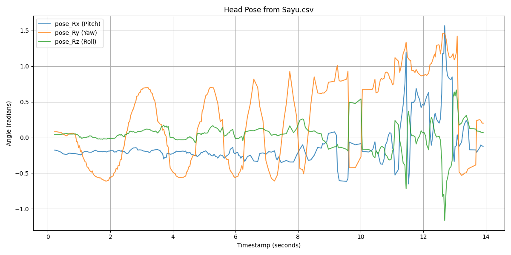
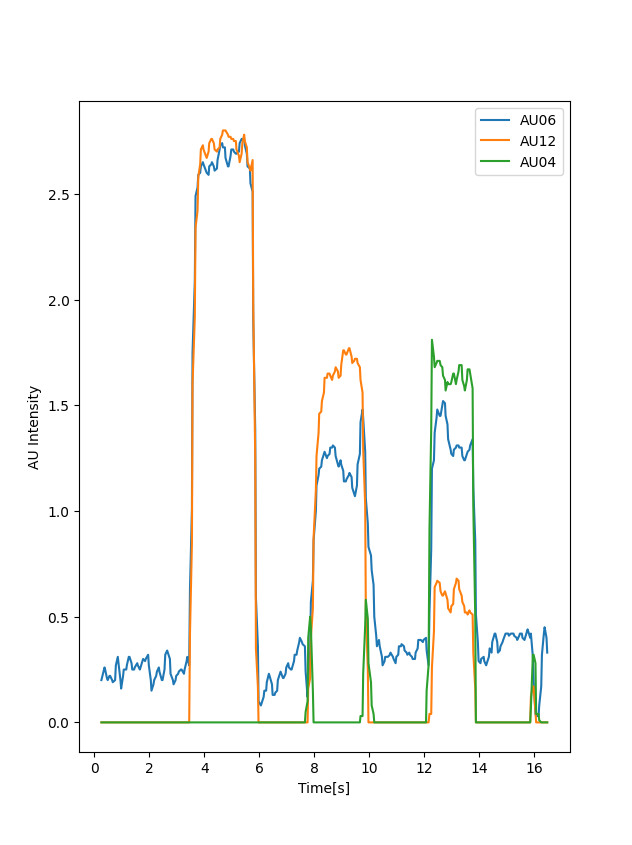
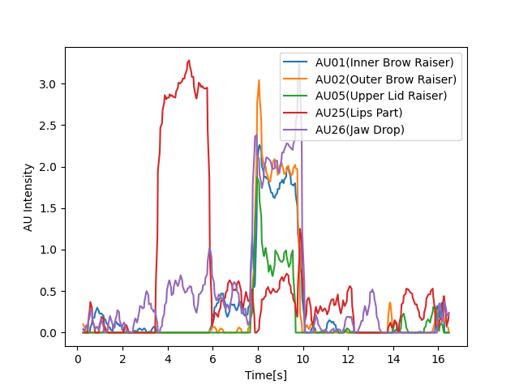
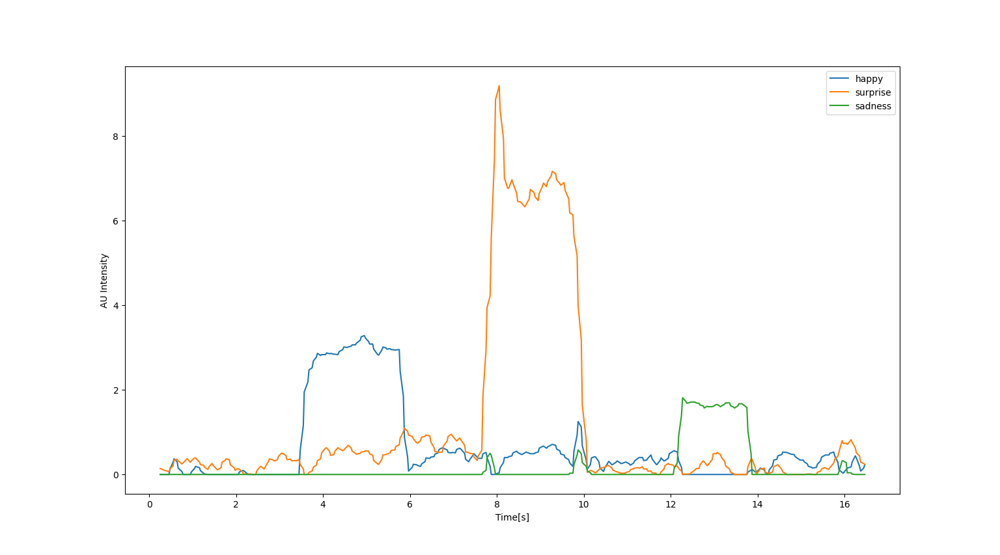
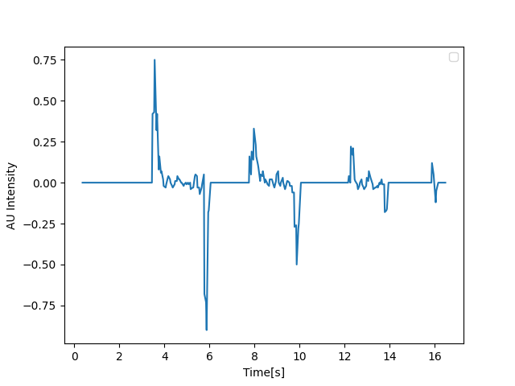
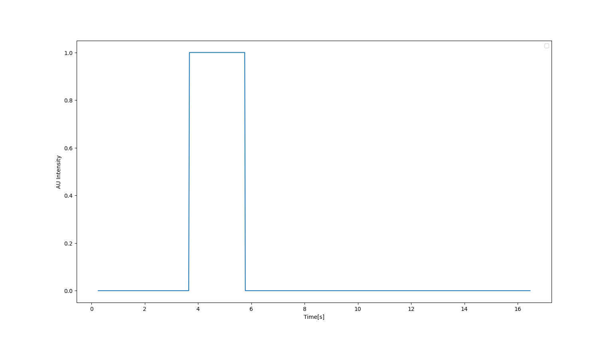
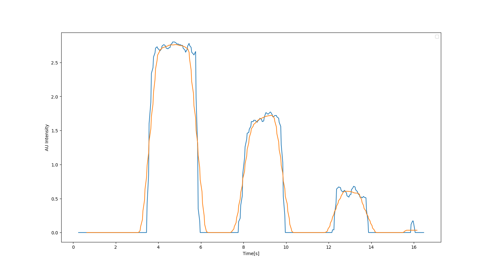
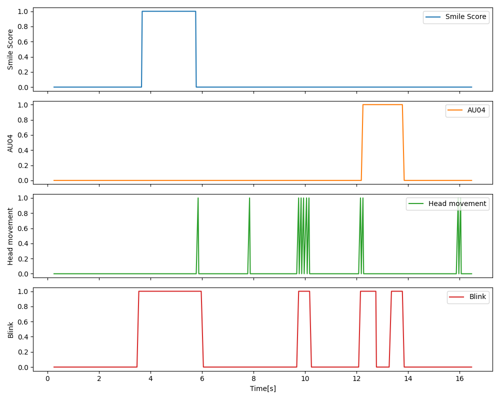
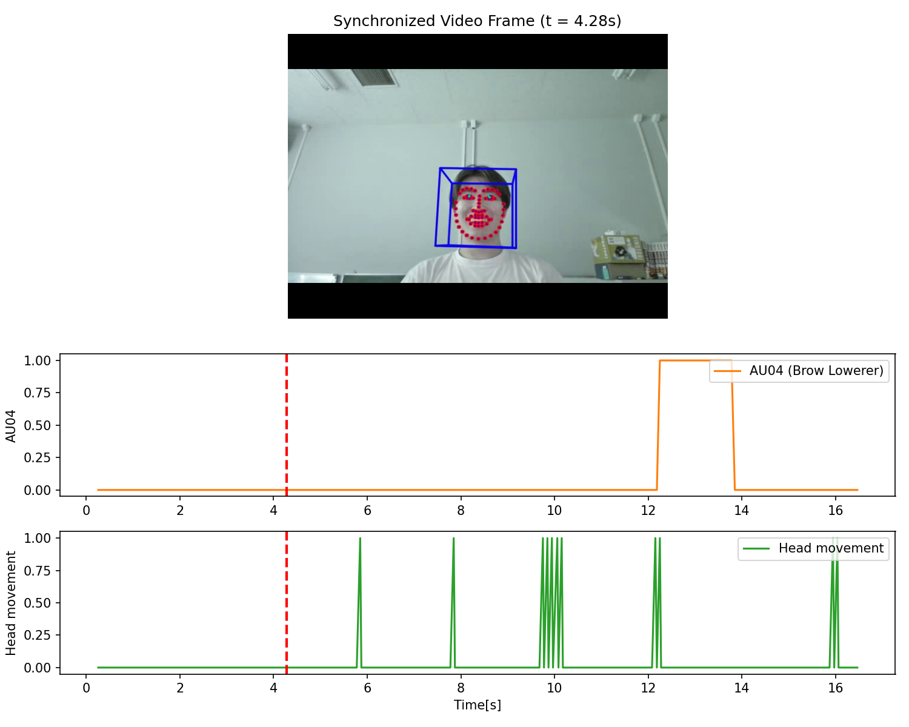

<!-- _class: lead -->
<!-- _paginate: false -->
<!-- _header: '' -->
<!-- _footer: '' -->

# OpenFaceを用いた顔画像からの<br>情動情報解析・時系列実装
### 〜 第1回〜第3回演習課題の実装完了と独自発展システムの開発報告 〜

**発表日:** 2026年10月22日 (Day 3)  
**所属:** 情報・データサイエンス学部 3年  
**進捗状況:** テキスト第1回〜第3回課題すべて完了 ＋ 独自同期ビューア開発完了

---

## 演習全体の進捗状況サマリー

シラバス全4回に対する我々の実作業（Day 1・Day 2）での前倒し達成対比

<div style="display: grid; grid-template-columns: 1fr 1fr 1fr; gap: 20px;">

<div class="card">

### 01. 第1回相当 (Day1実施)
**顔を「データ」として測る**
- OpenFace特徴量抽出の実行
- 頭部姿勢 (Pitch/Yaw/Roll) 解析
- 時系列プロット (`plot_sayu.py`)
- **成果:** `Sayu_pose.png`
</div>

<div class="card">

### 02. 第2回相当 (Day1実施)
**表情を数値として測る**
- FACS / Action Unit (AU) の抽出
- 笑顔 (AU06, 12) & 驚き (AU01,02,05,25,26)
- 独自情動指標の数式モデル化
- **成果:** `2-2.py`, `2-3.py`, `2-kadai.py`
</div>

<div class="card">

### 03. 第3回相当 (Day2実施)
**時間変化から情動を読む**
- フレーム間差分 (`diff`) & イベントフラグ化
- 移動平均フィルタによるノイズ低減
- 4段複合 Emotion Timeline 構築
- **独自発展:** 動画・グラフ同期プレイヤー
</div>

</div>

---

## 【Day 1 実績①】頭部姿勢の時系列可視化 (Head Pose)

動画中の頭部運動（左右・上下・傾き）を客観的な角度（rad）データとして抽出

<div class="grid-2">

<div>

### 実施内容と技術ポイント
- **対象データ:** `Sayu.csv` (頭部運動動画の解析結果)
- **抽出変数:** `pose_Rx` (Pitch: 上下), `pose_Ry` (Yaw: 左右), `pose_Rz` (Roll: 傾き)
- **コード (plot_sayu.py 抜粋):**
```python
df = pd.read_csv('Sayu.csv')
df.columns = df.columns.str.strip()
plt.plot(df['timestamp'], df['pose_Rx'], label='Pitch')
plt.plot(df['timestamp'], df['pose_Ry'], label='Yaw')
plt.plot(df['timestamp'], df['pose_Rz'], label='Roll')
plt.savefig('Sayu_pose.png')
```
- **知見:** 左右運動時に `pose_Ry` が±0.5 rad以上の明瞭な振れ幅を記録。身体動作を客観時系列ピークとして同定。

</div>

<div>



</div>

</div>

---

## 【Day 1 実績②】Action Unit (AU) による顔表情の数値化

FACS（顔面動作符号化システム）に基づく微小筋肉運動強度の定量化

<div class="grid-2">

<div>

### 観測対象と筋運動の対応
- **AU06_r (頬上げ):** 眼輪筋収縮。自然な笑顔で上昇。
- **AU12_r (口角上げ):** 大頬骨筋収縮。笑顔の主成分。
- **AU04_r (眉下げ):** 皺眉筋収縮。困惑・集中・不快。

### 作成コード (2-2.py)
```python
df = pd.read_csv('2-2.csv')
df.columns = df.columns.str.strip()
plt.plot(df['timestamp'], df['AU06_r'], label='AU06')
plt.plot(df['timestamp'], df['AU12_r'], label='AU12')
plt.plot(df['timestamp'], df['AU04_r'], label='AU04')
plt.legend(); plt.show()
```
- **考察:** 中盤の笑顔区間において AU06 と AU12 が同期して急上昇。客観的強度変化として記録。

</div>

<div>



</div>

</div>

---

## 【Day 1 実績③】複合AU解析と独自情動指標のモデリング

驚き(Surprise)の複数AU連動解析と、独自感情スコア（Happy, Sadness等）の設計

<div class="grid-2">

<div>

### 驚き区間の多変量解析 (2-3.py)
- 内外眉上げ(AU01,02)、上まぶた(AU05)、開口(AU25,26)の共起を可視化。



</div>

<div>

### 独自情動指標の設計 (2-kadai.py)
```python
# 独自Emotion Indexの数式定義
df["happy"] = df["AU25_r"]
df["surprise"] = (df["AU01_r"] + df["AU02_r"] 
                  + df["AU05_r"] + df["AU26_r"])
df["sadness"] = df["AU04_r"]
```



</div>

</div>

---

## 【Day 2 実績①】時系列差分とイベント検出フラグ化

静止画的特徴から動画時系列へ：急峻な変化点の抽出としきい値による離散イベント化

<div class="grid-2">

<div>

### ① フレーム間差分による変化点検出 (3-1.py)
- 表情の「立ち上がりモーメント」を抽出
```python
df["AU12_diff"] = df["AU12_r"].diff()
```



</div>

<div>

### ② 閾値判定によるイベントフラグ化 (3-2.py)
- 閾値2を超えた区間を笑顔イベント(1)として離散系列化
```python
df["smileFlag"] = (df["AU12_r"] > 2).astype(int)
```



</div>

</div>

---

## 【Day 2 実績②】移動平均フィルタによるノイズ低減と平滑化

顔画像トラッキング特有の高周波ノイズを除去し、本質的な情動トレンドを抽出

<div class="grid-2">

<div>

### 課題と平滑化アプローチ
- **課題:** 照明変化や微小な頭部揺らぎにより、フレーム単位のスパイクノイズが混入。
- **手法:** 移動平均（Rolling Mean with window=8, center=True）を適用。

### 作成コード (3-2_MA.py)
```python
df["AU_smooth"] = (
    df["AU12_r"]
    .rolling(window=8, center=True)
    .mean()
)
plt.plot(df['timestamp'], df["AU12_r"], label="Raw")
plt.plot(df['timestamp'], df["AU_smooth"], label="Smooth")
```
- **考察:** window=8（約0.25秒分）により、笑顔の立ち上がりを損なわずに微小振動を効果的に抑制。

</div>

<div>



</div>

</div>

---

## 【Day 2 実績③】複合時系列可視化（Emotion Timeline）

テキスト第3コマの到達目標：複数指標（表情・頭部・まばたき）の多段同期プロット

<div class="grid-2">

<div>

### 4段マルチプロットの構成定義
1. **Smile Score:** `(AU12_r > 2)` → 笑顔生起
2. **AU04:** `(AU04_r > 1)` → 眉間の緊張・集中
3. **Head movement:** `(pose_Rz.diff() < -0.005)` → 首の急な傾き
4. **Blink:** `(AU45_c > 0)` → まばたきパルス

### 作成コード (3-hukusen.py 抜粋)
```python
fig, axes = plt.subplots(4, 1, figsize=(10, 8), sharex=True)
axes[0].plot(df['timestamp'], df["Smile Score"])
axes[1].plot(df['timestamp'], df["AU04"])
axes[2].plot(df['timestamp'], df["Head movement"])
axes[3].plot(df['timestamp'], df["Blink"])
```
- **成果:** 「頷きと同時に笑顔が生じた」といった共起関係を把握可能。

</div>

<div>



</div>

</div>

---

## 【独自発展実装】動画・時系列グラフ リアルタイム同期プレイヤー

テキストの構想をさらに発展：OpenCVとMatplotlibのアニメーションによる完全同期可視化

<div class="grid-2">

<div>

### 独自開発のアーキテクチャ (3-WB.py)
- **構想の具現化:** テキスト記載の「上段に動画、中段にAU、下段に頭部運動」を**動的プレイヤー**として完全実装。
- **技術:** `cv2.VideoCapture` + `FuncAnimation`
- **連動機構:** 動画フレーム再生に合わせて赤色破線バー（`axvline`）が時系列上をリアルタイム追従。

```python
gs = fig.add_gridspec(3, 1, height_ratios=[2, 1, 1])
def update(frame_idx):
    ret, frame = cap.read()
    im.set_data(cv2.cvtColor(frame, cv2.COLOR_BGR2RGB))
    line_au.set_xdata([t, t])
    line_head.set_xdata([t, t])
    return im, line_au, line_head
```
- **効果:** 数値ピークと実際の表情変化を直感照合。

</div>

<div>



</div>

</div>

---

## 成果のまとめと第4回（ミニプロジェクト）への展望

第4回に向けた挑戦：マルチモーダル特徴量による『嘘発見器』の精度向上とアプリ開発

<div style="display: grid; grid-template-columns: 1fr 1fr; gap: 30px;">

<div class="card">

### ここまでの到達点（基盤確立）
1. **実活動2日間でテキスト全3回分を完全走破:**
   - 特徴抽出（頭部姿勢・AU・視線・瞬目）、AU多変量解析、時系列差分、ノイズ平滑化、Emotion Timelineまで一貫パイプラインを確立。
2. **独自同期アニメーションビューアの完成 (3-WB.py):**
   - 動画再生と時系列グラフのリアルタイム同期検証基盤を確立。
3. **データサイエンスの視座:**
   - 「Pixel → Feature → Behavior → State → Emotion」の推論階層を学び、観測（筋運動）と解釈（情動・心理推定）を厳密に区別する姿勢を習得。

</div>

<div class="card">

### 第4回 計画：『嘘発見器』の高度化＆アプリ開発
1. **嘘発見（虚偽検出）の精度向上アプローチ:**
   - **多変量特徴の統合:** まばたき急増(AU45)、視線の泳ぎ(gaze)、作り笑顔(AU12有/AU06無)、眉間の緊張(AU04)の複合解析
   - **微表情の差分検出:** 質問直後の急激な変化（マイクロエクスプレッション）を `diff()` で捕捉
   - **機械学習モデルの導入:** scikit-learnによる「真実回答時 vs 虚偽回答時」の分類器（SVM / Random Forest）学習
2. **実用的な『嘘発見アプリ』の開発:**
   - `3-WB.py` の同期技術を発展させ、Webカメラ映像から**「嘘らしさスコア(Deception Index)」**をリアルタイム判定・描画するGUIアプリを開発
   - 質問提示と連動した自動判定・ダッシュボードの構築

</div>

</div>
